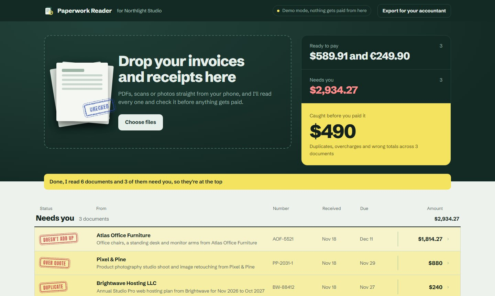
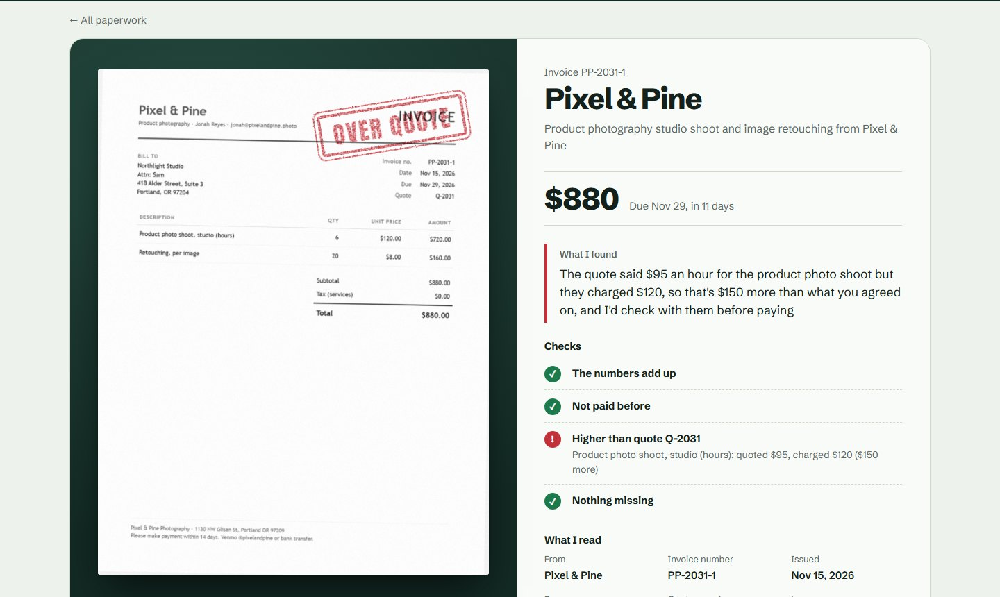
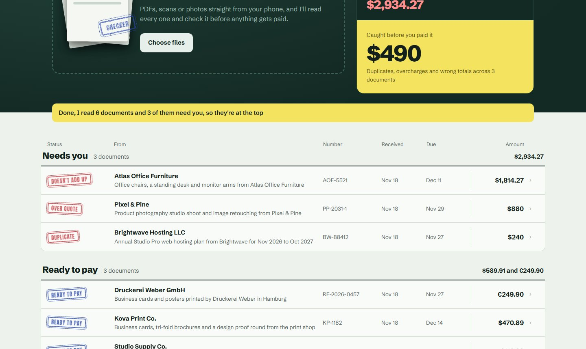

# n8n Invoice Checker

An n8n workflow that reads invoices and receipts, PDFs, scans or phone photos, and checks them before anything gets paid, so it catches the boring mistakes that usually slip through, like the same invoice sent twice, a price higher than the quote, or lines that don't add up.



## What it does

You drop documents on the page and for each one it:

- reads the supplier, invoice number, dates, line items, tax and total, in any language, and translates the lines to English
- checks the math line by line, then subtotal plus tax against the total
- checks if the same invoice came in before
- compares every unit price with the quote you already agreed to
- flags anything missing, like a due date, or anything it couldn't read clearly

Anything that's off gets a stamp and a short note saying what to check, and the rest is either ready to pay or filed as an already paid receipt. Everything exports to CSV for your accountant.



## How it works

The idea I kept coming back to is that the AI should only read, and every decision should be plain code, because that's what makes it reliable enough to trust with money.

- **Upload:** a Webhook node takes the multipart upload, and a Code node splits it into one item per file with the binary as base64
- **Reading:** an HTTP Request node sends each file to the Anthropic Messages API, PDFs as a `document` block and photos as an `image` block, with a JSON schema for the output, so every field comes back structured with its own confidence (`high`, `medium`, `low`, `absent`). The prompt tells the model to report the printed numbers and never fix them, because a quietly corrected total is exactly the mistake you wanted to catch
- **Checking:** one Code node (`nodes/check.js`) does every check in plain JS against the Data Tables, and writes the note for each document
- **Pages:** the dashboard and the document page are HTML built in Code nodes and returned with Respond to Webhook. The upload webhook answers when the last node finishes, with a 303 redirect, so the browser just waits while it reads and then lands on the updated list, no polling



## Workflows

| File | What it does |
|---|---|
| `workflows/0-setup.json` | Creates the three Data Tables and loads the demo data, plus a reset link for testing |
| `workflows/1-read-documents.json` | The upload, the AI reading, the checks, and saving the results |
| `workflows/2-pages.json` | The dashboard, the document page, approve or reject, and the CSV export |

## Setup

You need a self-hosted n8n with Data Tables (I built it on n8n 2.48) and an Anthropic API key.

1. Import the three files from `workflows/` into n8n
2. Open **Paperwork Reader · 1 Read documents**, click the **AI reads the document** node, and pick your Anthropic credential (or create one with your API key)
3. Publish all three workflows
4. Create the tables and the demo data:
   ```bash
   curl -X POST http://localhost:5678/webhook/papers-setup
   ```
5. Open `http://localhost:5678/webhook/papers` and drop in the files from `samples/demo-upload`

To start over at any time, use **Reset demo data** at the bottom of the page. Reset only works while `testMode` is `true` in `config.json`.

## Changing it

The workflows are generated from the files in `nodes/`, so the easiest way to change anything is to edit those, then rebuild and import again:

```bash
node build.js
```

`config.json` holds the business name, currency, the AI model, and an optional credential id if you want the build to attach your credential automatically.

## Demo documents

Everything in `samples/` is made up for the demo: three PDFs, a scanned invoice, a phone photo of a receipt, and a phone photo of an invoice in German. Two of them have mistakes on purpose, a photographer who billed $120 an hour on a $95 quote, and an invoice whose lines add up to $100 less than its subtotal. `samples/make-html.js` and `samples/make-docs.ps1` are what generated them, if you want to make your own.

## Notes

- It never pays anything, it only reads, checks, and lets you approve or reject
- Each document is one AI call, so the cost depends on the model you choose in `config.json`
- Data Tables' "create if not exists" got confused when one table name was part of another, so the tables are named so that none contains another

## License

MIT
